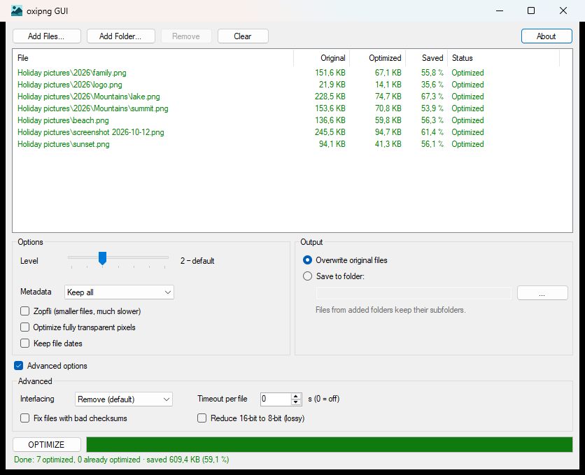

#  oxipng GUI

A small Windows tool that makes PNG files smaller without changing a single pixel. It's a simple front end for [oxipng](https://github.com/oxipng/oxipng), the lossless PNG optimizer, and it carries oxipng inside: nothing to install, no command line.

<p align="center">
  
</p>

## Why?

Most PNG files are stored less efficiently than they could be. Screenshots, image editors and exports usually pick a quick, average compression. oxipng tries a range of encodings for the same image and keeps the smallest one, which often saves 10 to 60 percent while every pixel stays exactly the same.

oxipng itself is a command-line program. oxipng GUI puts it behind a window you can drop files on.

## Features

- Drop PNG files or whole folders onto the window, or use **Add Files...** and **Add Folder...**. Folders are searched recursively for `.png` and `.apng` files.
- Lossless: an optimized file shows exactly the same image as the original.
- Overwrites the originals or saves optimized copies to a folder of your choice, keeping the subfolders of added folders.
- The common oxipng options are a click away: optimization level, metadata, Zopfli, transparent pixels and file dates. Rarer ones sit in a collapsible **Advanced options** group.
- The defaults are the same as running `oxipng` on the command line.
- Takes oxipng's command-line options, so a shortcut or script can open the window with files and options already set, or start optimizing right away.
- Optimizes several files at once and uses every CPU core.
- Shows each file's size before and after and how much was saved. Files that fail show oxipng's reason.
- **STOP** works at any time. Files that aren't finished stay exactly as they were.
- Remembers your settings.
- A single exe. oxipng is embedded, so there's nothing else to install.

## Requirements

- Windows 10 or 11, 64-bit, with .NET Framework 4.8, which is built into Windows 10 (version 1903 and later) and Windows 11.
- The Microsoft Visual C++ Redistributable (x64), which the official oxipng build needs. Most PCs already have it. If yours doesn't, the app says so and offers to open Microsoft's download.

## Installation

1. Download the latest build from the [Releases](../../releases/latest) page.
2. Put `oxipng_GUI.exe` in a folder of your choice and run it. There's no installer; oxipng is embedded in the exe.

The first time you optimize, the app unpacks its copy of oxipng to `%LOCALAPPDATA%\oxipng_GUI\oxipng\<version>\`.

## Usage

### Optimizing files

1. Drop PNG files or folders onto the list, or click **Add Files...** or **Add Folder...**. You can also drop files onto `oxipng_GUI.exe` itself or put a shortcut to it into your *Send to* menu.
2. Check the options. The defaults suit most files.
3. Click **OPTIMIZE**. The list fills in as files finish, and the bar at the bottom adds everything up.

Hover over a file to see its full path and, if it failed, why. Right-click a file to show it in Explorer or remove it from the list, or press `Del`.

### Options

| Option | What it does | oxipng flag |
| --- | --- | --- |
| Level | 0 is fastest, 6 tries the most strategies. 2 is oxipng's default and a good balance. | `--opt` |
| Metadata | *Keep all* changes only the compression. *Strip safely* removes text, EXIF and other metadata that doesn't change how the image looks; color profiles stay. *Strip all* removes every optional chunk, which can shift colors in color-managed viewers. | `--strip safe`, `--strip all` |
| Zopfli | A much slower compressor that usually saves a few percent more. | `--zopfli` |
| Optimize fully transparent pixels | Changes the hidden color of fully transparent pixels so they compress better. The image looks the same, but its pixel data changes. | `--alpha` |
| Keep file dates | Keeps each file's modification date instead of setting it to now. | `--preserve` |
| Interlacing *(advanced)* | *Remove* is oxipng's default and makes files smaller. *Keep* leaves interlacing as it is. *Add* enables progressive loading but usually makes files larger; oxipng skips it where it would. | `--interlace` |
| Timeout per file *(advanced)* | Stops trying new strategies on a file after this many seconds and keeps the best result so far. 0 means no limit. | `--timeout` |
| Fix files with bad checksums *(advanced)* | Repairs files with broken chunk checksums instead of rejecting them. | `--fix` |
| Reduce 16-bit to 8-bit *(advanced)* | Converts 16-bit images to 8-bit. This changes pixel values, so it isn't lossless. | `--scale16` |

Hover over an option in the app for the same explanation.

### Where the files go

- **Overwrite original files** replaces each file with its optimized version. A file that can't be made smaller is left untouched.
- **Save to folder** writes optimized copies and never touches the originals. Files that came from an added folder keep their place below it, so adding `D:\Pictures` writes `D:\Pictures\2026\beach.png` to `<output folder>\Pictures\2026\beach.png`. Files you added on their own go straight into the output folder. Files that can't be made smaller are copied unchanged.

### Running it again

**OPTIMIZE** only processes files that aren't finished yet, for example after you stopped a run or fixed a file that failed. Once you change a setting, every file in the list runs again with the new settings. Adding a file that's already in the list also queues it again.

The app remembers its settings and the last folders you used. They're stored per Windows user under `%LOCALAPPDATA%\oxipng_GUI\`.

### Command line

`oxipng_GUI.exe` adds the PNG files and folders it's started with to the list. That's what happens when you drop files onto the exe or use a *Send to* shortcut. *Open with* works too, but Explorer starts the app once for every selected file, so to get several files into one window, drop them onto the exe or use *Send to*.

It also takes oxipng's own options. They set up the window for this launch only: it starts from oxipng's defaults plus the options you pass, as if you ran oxipng with them, and nothing is saved. Without options, the window opens with your saved settings as usual. Add `--run` to start optimizing as soon as the files are listed.

```powershell
oxipng_GUI.exe -o 4 --strip safe --run "D:\Pictures"
```

- Options that have a control in the window set that control: `-o`/`--opt`, `-s`, `--strip safe` and `--strip all`, `-z`/`--zopfli`, `-a`/`--alpha`, `-p`/`--preserve`, `-i`/`--interlace`, `--timeout`, `--fix` and `--scale16`. `--dir <folder>` selects **Save to folder** with that folder.
- The other optimization options, such as `--zc`, `-f`/`--filters`, `--fast`, `--nx`, `--keep`, `--strip` with a list of chunks, or `--force`, go to oxipng unchanged. The window lists them above **OPTIMIZE** and locks the controls they decide, for example **Metadata** for `--keep`.
- `-r`, `-q`, `-v`, `-j`, `-t` and `--sequential` are accepted and have no effect. Folders are always searched recursively, and the app chooses the number of threads itself.
- `--out`, `--stdout`, `--dry-run` and `-` (standard input) aren't supported, because the app reads and writes the files itself.

`oxipng_GUI.exe --help` lists every option, and `--version` (`-V`) shows the app and oxipng versions. If the command line is invalid, the app says what's wrong and exits with code 2.

## How it works

### Bundled oxipng

`oxipng_GUI.csproj` pins an oxipng version and the SHA-256 of its official Windows release zip. The first build downloads the zip from GitHub, checks the hash and embeds `oxipng.exe` and its license in the app. A download that doesn't match fails the build.

At runtime, `EmbeddedOxipngBinary` unpacks `oxipng.exe` to `%LOCALAPPDATA%\oxipng_GUI\oxipng\<version>\`, compares it byte by byte with the embedded copy and keeps it open read-only while the app runs, so it can't be swapped behind the app's back. Before the first batch it runs `oxipng --version` once, which catches a missing Visual C++ runtime or a blocked exe before any file is touched.

### Safe writes

Left alone, oxipng overwrites a file in place by truncating it and writing the new data. If it were stopped halfway, the original would be damaged. So the app never lets oxipng write an original. Each file runs roughly like this:

```text
oxipng --opt 2 --threads 2 --quiet --json --out "C:\Pictures\~oxipng-1a2b3c4d.tmp" "C:\Pictures\beach.png"
```

The result goes to a temp file next to the target and replaces the target with `ReplaceFile` only once it's complete and smaller. A backup of the original is kept until the swap has succeeded. Read-only files are skipped, and a file that changed on disk while it was being optimized is left alone. oxipng reports each file as JSON, which is where the error messages in the list come from.

### Parallel processing

oxipng runs once per file, with as many files at a time as the PC has logical processors. The cores are split between them, so a single file still gets all of them. The largest files go first. Every oxipng process belongs to a Windows job object, so closing the app, or the app crashing, ends them too.

## Building from source

You need Windows and **Visual Studio 2026** with the **.NET desktop development** workload. The code uses C# 14 features, which older compilers reject. The first build needs internet access to download oxipng.

1. Clone the repository and open `oxipng_GUI.slnx`.
2. Select the **Release** configuration and build. NuGet restores the packages and MSBuild downloads oxipng into `oxipng_GUI\obj\oxipng\`.
3. The app is written to `oxipng_GUI\bin\Release\net48\`.

To build from the command line, open a **Developer PowerShell for VS 2026** in the repository folder and run:

```powershell
msbuild oxipng_GUI.slnx -restore -p:Configuration=Release
```

`dotnet build` doesn't work for this project. The .NET SDK's MSBuild can't embed the window icon (a non-string resource) in a .NET Framework app and fails with `MSB3822`/`MSB3823`.

[Costura.Fody](https://github.com/Fody/Costura) embeds NuGet dependencies into the exe at build time, so the output folder contains only `oxipng_GUI.exe`, its `.exe.config` and the `.pdb`.

### Updating oxipng

Change `OxipngVersion` and `OxipngSha256` in `oxipng_GUI/oxipng_GUI.csproj` and build. The hash is the SHA-256 of `oxipng-<version>-x86_64-pc-windows-msvc.zip`, which the GitHub release page lists next to the asset. If you get it wrong, the build fails and prints the actual hash; check it against the release page before you copy it. Also review `THIRD-PARTY-NOTICES.txt` when oxipng's dependencies change.

### Tech stack

| Area | Used |
| --- | --- |
| Language | C# 14 (`LangVersion` latest, nullable reference types) |
| Framework | .NET Framework 4.8, Windows Forms |
| Optimizer | [oxipng](https://github.com/oxipng/oxipng) 10.2.1, official Windows x64 build, embedded |
| Folder picker | [Ookii.Dialogs.WinForms](https://github.com/ookii-dialogs/ookii-dialogs-winforms) 4.0.0 |
| Command line | [System.CommandLine](https://github.com/dotnet/command-line-api) 2.0.14 |
| Packaging | [Costura.Fody](https://github.com/Fody/Costura) 6.2.0 |
| Native APIs | Job objects (kernel32), `StrCmpLogicalW` (shlwapi) |

### Project structure

```text
oxipng_GUI.slnx                      Solution
THIRD-PARTY-NOTICES.txt              Licenses of the bundled libraries and of the code inside oxipng.exe
oxipng_GUI/
├── Program.cs                       Entry point; reads the command line and wires up the services
├── Forms/
│   ├── MainForm.cs                  Main window: file list, options, output, run
│   ├── BufferedListView.cs          Double-buffered list, so updates don't flicker
│   ├── AboutForm.cs                 Version and license texts
│   └── CommandLineHelpForm.cs       The --help text
├── Models/                          Options, files, results and settings
├── Services/
│   ├── BatchOptimizer.cs            Runs files in parallel and reports progress
│   ├── OxipngOptimizer.cs           One file: temp output, checks, safe replace
│   ├── OxipngArguments.cs           Options to oxipng command-line flags
│   ├── OxipngReport.cs              Reads oxipng's JSON result
│   ├── OutputPlanner.cs             Target paths and name conflicts
│   ├── EmbeddedOxipngBinary.cs      Unpacks and checks the embedded oxipng.exe
│   ├── ProcessRunner.cs             Starts processes and stops them on cancel
│   ├── PngFileCollector.cs          Finds PNG files in dropped files and folders
│   ├── SettingsStore.cs             Loads and saves the user settings
│   ├── LaunchArgumentsParser.cs     Reads the command line with System.CommandLine
│   ├── LaunchArguments.cs           Files, options and switches from the command line
│   ├── LaunchSettingsStore.cs       Applies command-line options without saving them
│   └── EmbeddedResources.cs         Embedded files and build metadata
├── Utils/
│   ├── KillOnCloseJob.cs            Job object that ends oxipng with the app
│   ├── CommandLine.cs               Windows command-line quoting
│   ├── NaturalFileNameComparer.cs   Explorer-style natural sort
│   ├── ByteSize.cs                  File sizes as text
│   ├── FileHelper.cs                Best-effort deletes
│   └── IOHelper.cs                  File and folder pickers, Explorer, links
├── Properties/Settings.settings     Remembered options and folders
└── Resources/                       App icon
```

## Troubleshooting

### "oxipng needs the Microsoft Visual C++ Redistributable (x64)"

The official oxipng build uses Microsoft's C++ runtime, which isn't part of a fresh Windows install. Let the app open the download, or get it from [aka.ms/vc14/vc_redist.x64.exe](https://aka.ms/vc14/vc_redist.x64.exe), install it and click **OPTIMIZE** again. There's no need to restart the app.

### "oxipng couldn't be started"

Usually a virus scanner or an application control policy blocked `%LOCALAPPDATA%\oxipng_GUI\oxipng\<version>\oxipng.exe`. Allow that file and try again. The message names the exact problem.

### A file fails

The Status column and the file's tooltip show the reason:

- **Invalid header detected; Not a PNG file**: the file isn't a PNG, whatever its name says.
- **The file is read-only.**: clear the read-only attribute in the file's properties.
- **The file changed while it was being optimized.**: another program wrote to the file. Close it and optimize again.
- **Another file in the list would be written to the same place.**: in *Save to folder* mode, two files you added on their own have the same name. Add their folders instead, or optimize them separately.
- Checksum errors: try **Fix files with bad checksums** under **Advanced options**.

### Leftover `~oxipng-*.tmp` files

The app removes its temp files itself. If the PC lost power or the app was killed while a file was being written, a `~oxipng-xxxxxxxx.tmp` file can stay behind next to it. It's safe to delete. A `~oxipng-xxxxxxxx.tmp.bak` file holds an original from the moment it was being replaced: if the original is missing, rename the `.bak` file back to the original name.

## Limitations

- Windows 10 and 11, 64-bit only, because the official oxipng Windows build is 64-bit.
- PNG and APNG only. oxipng doesn't handle JPEG, GIF or WebP.
- Paths longer than 260 characters aren't supported.
- English user interface only.

## Credits

- [oxipng](https://github.com/oxipng/oxipng) (MIT) by Joshua Holmer and contributors does all the optimizing. Its official Windows build is embedded in the app. `THIRD-PARTY-NOTICES.txt` lists the libraries inside it.
- The app icon is the avatar of the [oxipng GitHub organization](https://github.com/oxipng).
- [Ookii.Dialogs.WinForms](https://github.com/ookii-dialogs/ookii-dialogs-winforms) (BSD-3-Clause) provides the modern folder picker.
- [System.CommandLine](https://github.com/dotnet/command-line-api) (MIT) reads the command line.
- [Costura.Fody](https://github.com/Fody/Costura) (MIT) packs dependencies into the exe.

## License

Released under the [MIT License](LICENSE.txt).

This is an independent project. It isn't affiliated with or endorsed by the oxipng developers.
